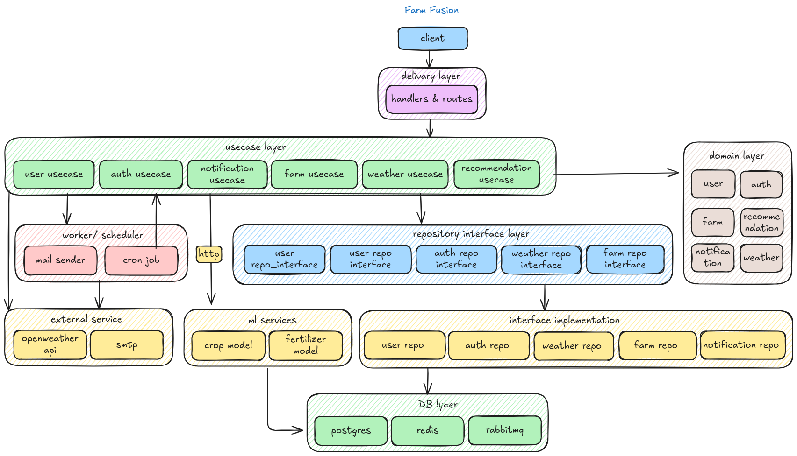

# Farm Fusion

**Intelligent Agricultural Recommendation System with Weather Monitoring**

A platform that combines machine learning, real-time weather monitoring, and automated notifications to help farmers make data-driven decisions about crop selection and fertilizer usage.

This document covers not just what was built, but why each technical decision was made.

---

## Why This Project Matters

### The Problem
Farmers face critical decisions daily:
- **What crop should I plant?** (Wrong choice = entire season lost)
- **What fertilizer do I need?** (Wrong amount = money wasted or crops damaged)
- **Will weather harm my crops?** (Late warning = no time to protect)

### The Solution
An intelligent system that:
- Recommends optimal crops based on soil conditions (99.5% mean 5-fold cross-validated accuracy on the bundled dataset)
- Suggests precise fertilizer types based on soil and crop data
- Monitors weather 24/7 and sends automated alerts before dangerous conditions
- Scales to handle thousands of farms with minimal latency

### Real-World Impact
- **Time Saved:** Automated daily weather checks for all farms
- **Cost Reduction:** Precise fertilizer recommendations prevent waste
- **Risk Mitigation:** Early weather warnings protect crops
- **Data-Driven:** ML models trained on 2,200+ agricultural data points

---

## System Architecture

### High-Level Overview



### Architecture Principles

**Clean Architecture**
- Domain entities are independent of frameworks
- Business logic isolated from infrastructure
- Dependencies point inward (Dependency Inversion)
- Go API: Authentication, business logic, orchestration
- Python ML: Model inference (scikit-learn)

**Event-Driven Architecture**
- RabbitMQ decouples notification generation from email sending
- Async processing prevents API blocking
- Retry logic for failed emails

---

## API Endpoints

### Main API (Go)

| Method | Endpoint | Auth | Description |
|--------|----------|------|-------------|
| GET | `/healthz` | No | Liveness probe |
| GET | `/readyz` | No | Readiness probe (verifies DB connectivity) |
| POST | `/api/v1/auth/register` | No | Register a new user. Always returns `202` with the same body, whether or not the email is taken |
| POST | `/api/v1/auth/login` | No | Login and receive tokens. 5 failed attempts lock the account for 15 minutes |
| POST | `/api/v1/auth/refresh` | No | Rotate refresh token and issue new token pair |
| POST | `/api/v1/auth/logout` | No | Revoke the refresh token, and the access token if sent as `Authorization: Bearer` |
| POST | `/api/v1/auth/logout-all` | Yes | Revoke every session for the caller, including outstanding access tokens |
| GET | `/api/v1/users/me` | Yes | Get current user profile |
| PATCH | `/api/v1/users/me` | Yes | Update current user profile. Changing `email` requires `current_password` |
| DELETE | `/api/v1/users/me` | Yes | Delete current user account |
| GET | `/api/v1/users` | Admin | List all users (admin role required) |
| GET | `/api/v1/users/{id}` | Owner/Admin | Get user by ID |
| PATCH | `/api/v1/users/{id}` | Owner/Admin | Update user by ID |
| DELETE | `/api/v1/users/{id}` | Owner/Admin | Delete user by ID |
| POST | `/api/v1/farms` | Yes | Create a new farm |
| GET | `/api/v1/farms` | Yes | List all farms for user |
| GET | `/api/v1/farms/{farmID}` | Yes | Get a specific farm |
| PUT | `/api/v1/farms/{farmID}` | Yes | Update a farm |
| DELETE | `/api/v1/farms/{farmID}` | Yes | Delete a farm |
| POST | `/api/v1/farms/{farmID}/weather-alerts` | Yes | Create a weather alert |
| GET | `/api/v1/farms/{farmID}/weather-alerts` | Yes | List weather alerts for farm |
| GET | `/api/v1/farms/{farmID}/weather-alerts/{weatherID}` | Yes | Get a specific weather alert |
| PUT | `/api/v1/farms/{farmID}/weather-alerts/{weatherID}` | Yes | Update a weather alert |
| DELETE | `/api/v1/farms/{farmID}/weather-alerts/{weatherID}` | Yes | Delete a weather alert |
| POST | `/api/v1/recommend/crop` | Yes | Get crop recommendation |
| POST | `/api/v1/recommend/fertilizer` | Yes | Get fertilizer recommendation |

### ML Service (FastAPI, internal)

Called by the Go API via `ML_SERVICE_URL`. Not exposed as part of the main REST API.

| Method | Endpoint | Description |
|--------|----------|-------------|
| GET | `/` | Service status |
| GET | `/health` | Returns `503` until the models are trained |
| POST | `/predict/crop` | Crop recommendation inference |
| POST | `/predict/fertilizer` | Fertilizer recommendation inference |

Both `/predict` routes require the `X-Internal-API-Key` header. The service and the Go API refuse to start unless `ML_API_KEY` is at least 32 bytes and is not the `.env.example` placeholder. Input bounds come from `ml_service/feature_bounds.json`, which the Go service is tested against.

---

## Domain Deep Dive

### ML Recommendation Domain

**Problem:** Provide accurate crop and fertilizer recommendations using ML models

**Architecture:**

```
┌─────────────────────────────────────────────────────────┐
│              ML RECOMMENDATION SYSTEM                    │
└─────────────────────────────────────────────────────────┘

Go Backend                    Python ML Service
    │                              │
    │  POST /predict/crop          │
    ├─────────────────────────────▶│
    │  {N, P, K, temp, humidity,   │
    │   ph, rainfall}               │
    │                              │
    │                         ┌────┴────┐
    │                         │ Load    │
    │                         │ Model   │
    │                         └────┬────┘
    │                              │
    │                              ▼
    │                         ┌──────────────┐
    │                         │ Run Various  │
    │                         │model & choose│
    │                         └──────┬───────┘
    │                              │
    │                         ┌────▼────┐
    │                         │ Get Top │
    │                         │ 3 Probs │
    │                         └────┬────┘
    │                              │
    │  {crop: "rice",              │
    │   confidence: 0.99,          │
    │◀─────────────────────────────┤
    │   alternatives: [...]}       │
    │                              │


Model Training (at service startup):

┌──────────────┐    ┌──────────────────┐    ┌──────────────┐    ┌──────────────┐
│ CSV Dataset  │───▶│ Stratified 5-fold│───▶│ Accuracy gate│───▶│ Refit on all │
│ (bundled)    │    │ CV, encoder per  │    │ (refuse to   │    │ rows, serve  │
└──────────────┘    │ fold             │    │  start)      │    │ from memory  │
                    └──────────────────┘    └──────────────┘    └──────────────┘
```

**What We Did:**
- Train a Random Forest per task from the CSVs when the service starts. No model files are loaded, so nothing is unpickled
- Created a separate Python FastAPI service for ML inference
- Implemented HTTP client in Go to call the ML service
- Added confidence thresholds and warnings

**Why Python for ML, Go for API:**
Python has the richest ML ecosystem (scikit-learn, pandas, numpy). Go excels at building fast, concurrent web APIs. Separating them lets each language do what it does best.

**Why Classifier (Not Regressor)?**

Input: Soil nutrients (N, P, K), weather (temp, humidity, rainfall), pH.
Output: **Crop name** (rice, wheat, maize, etc.) — **Discrete categories**

Classification predicts discrete categories like "rice" or "wheat". Regression predicts continuous numbers like 45.7 or 123.4. Since we're predicting *which crop*, not *how much of something*, classification is the correct approach.

**Why Random Forest (Not a Single Decision Tree)?**

```
Single Decision Tree Problems:
                    [N > 50?]
                   /         \
              [Yes]           [No]
             /                    \
      [P > 30?]              [Humidity > 80?]
      /      \                /            \
   Rice    Wheat          Maize          Jute

Problems:
 • Overfitting - Memorizes training data
 • High variance - Small data change = completely different tree
 • Unstable - Sensitive to noise
 • Lower accuracy - Single perspective
```

```
Random Forest = Ensemble of Many Trees:

Tree 1: Focuses on N, P, K
Tree 2: Focuses on Temperature, Humidity
Tree 3: Focuses on pH, Rainfall
...
Tree 100: Different feature combinations

Final Prediction = Majority Vote

Tree 1: Rice (90%)
Tree 2: Rice (85%)
Tree 3: Wheat (60%)
Tree 4: Rice (95%)
...
Tree 100: Rice (88%)

Result: Rice (87 trees voted Rice)
```

**Model Performance** (mean stratified 5-fold cross-validated accuracy, from `ml_service/metrics/model_report.json`, scikit-learn 1.9.1):

| Model | Rows | Classes | Accuracy (std) | Startup gate |
|-------|------|---------|----------------|--------------|
| Crop | 2,200 | 22, 100 rows each | 0.9955 (0.0032) | 0.97 |
| Fertilizer | 99 | 7, 7 to 22 rows each | 0.9800 (0.0245) | 0.90 |

The fertilizer set is small. Two classes (`17-17-17`, `10-26-26`) have only 7 rows, so treat its score as a rough estimate. Both models use `RandomForestClassifier(n_estimators=100, random_state=42)` with no feature scaling or depth limit. Regenerate the report with `python train_models.py`.

---

### Why Round Coordinates for Weather Caching?

**What We Did:** Round GPS coordinates to 2 decimal places and use them as cache keys.

```go
Farm A: lat=23.8103, lon=90.4125 → location_key="23.81_90.41"
Farm B: lat=23.8156, lon=90.4189 → location_key="23.82_90.42"
Farm C: lat=23.8099, lon=90.4134 → location_key="23.81_90.41"

Result: Farm A and C share the same weather cache entry
```

**Why not use exact coordinates?**

**API Cost:**
```
Without Rounding:
- 100 farms × unique coords = 100 API calls/day

With Rounding (2 decimal places):
- 100 farms grouped into ~4 location keys = 4 API calls/day
- Cost reduction: 96%
```

**Accuracy is not sacrificed:**
```
0.01° latitude  ≈ 1.11 km
0.01° longitude ≈ 1.11 km (at equator)

OpenWeather grid resolution: ~10-15 km squares
→ Farms within 1 km receive identical forecast data anyway
→ Temperature difference between two farms 650m apart: ±0.1°C (negligible)
```

**Cache efficiency:**
```
Without Rounding: Cache hit rate ~5%  (every farm is unique)
With Rounding:    Cache hit rate ~95% (farms share keys)
Performance gain: 20x faster on cache hits
```

**Scales naturally:**
```
100 farms   → ~4 unique location keys   (under free API tier)
10,000 farms → ~400 unique location keys (still under free tier)
```

---

### Weather Notification Domain

**Problem:** Automatically alert farmers about dangerous weather conditions

**Architecture:**
```
┌─────────────────────────────────────────────────────────────────┐
│                    WEATHER NOTIFICATION SYSTEM                  │
└─────────────────────────────────────────────────────────────────┘

┌────────────────────┐   ┌─────────────────────────────────────┐
│   CRON (5 AM)      │   │        DATABASE QUERIES             │
│   ───────────      │   │   ───────────────────────────       │
│ • Start daily      │   │   • Fetch all farms                 │
│   scheduler        │──▶│   • Get user emails per farm        │
└────────────────────┘   │   • Get alert thresholds            │
                         └─────────────────────────────────────┘
                                    │
                                    ▼
┌─────────────────────────────────────────────────────────────────┐
│                      FARM PROCESSING LOOP                       │
├─────────────────────────────────────────────────────────────────┤
│ 1. Check Redis Cache ──────┐                                    │
│    • HIT: Use cached       │   ┌─────────────────────────────┐  │
│    • MISS: Call API        │◀──│ OPENWEATHER API CALL        │  │
│                            │   │ ───────────────────────     │  │
│ 2. Detect Alerts:          │   │ • Get 24-hour forecast      │  │
│    • Temp < 15°C           │   │ • Cache result (3hr TTL)    │  │
│    • Temp > 35°C           │   └─────────────────────────────┘  │
│    • Rainfall > 50mm       │                                    │
│    • Humidity > 80%        │                                    │
│    • Wind > 40 km/h        │                                    │
│                            │                                    │
│ 3. Generate Summary        │                                    │
└────────────────────────────┼────────────────────────────────────┘
                             │
                             ▼
┌─────────────────────────────────────────────────────────────────┐
│                   RABBITMQ PUBLISHING                           │
│  ┌──────────────────────────────────────────────────────────┐   │
│  │ {                                                        │   │
│  │   "farm_id": "123",                                      │   │
│  │   "user_email": "user@example.com",                      │   │
│  │   "alerts": ["Temp > 35°C"],                             │   │
│  │   "summary": "Sunny, high of 38°C"                       │   │
│  │ }                                                        │   │
│  └──────────────────────────────────────────────────────────┘   │
└─────────────────────────────────────────────────────────────────┘
                             │
                             ▼
┌─────────────────────────────────────────────────────────────────┐
│                    WORKER CONSUMER                              │
├─────────────────────────────────────────────────────────────────┤
│ 1. Receive message from queue                                   │
│ 2. Claim notification_id in notification_log (skip if sent)     │
│ 3. Generate HTML email (alerts + forecast summary)              │
│ 4. Send via SMTP to the user's current email                    │
│ 5. Mark sent, then acknowledge message                          │
└─────────────────────────────────────────────────────────────────┘
```

**Delivery guarantees:**
- The scheduler reserves one `notification_outbox` row per farm per day before publishing. A rerun the same day, or a second scheduler replica, does not publish again. A Postgres advisory lock lets only one scheduler run at a time.
- A failed run is retried after 1, 5, and 15 minutes. With `SCHEDULER_RUN_ONCE=true` the process exits non-zero if any farm failed.
- The worker dedupes on `notification_id`, so a redelivered message does not send a second email.
- Retries are republished with publisher confirms before the original is acked. After the retry limit a message is dead-lettered to the DLQ, and the worker logs DLQ depth every 5 minutes.
- The scheduler runs at `SCHEDULER_HOUR:00` in `SCHEDULER_TIMEZONE`, and stays on that local hour across DST changes.

> **Upgrading an existing RabbitMQ:** the main queue now declares dead-letter arguments. RabbitMQ refuses to redeclare an existing queue with different arguments, so drain and delete the old `weather.notifications` queue (for example in the management UI) before starting the new worker or scheduler.

**Why Scheduled at 5 AM, Not Real-Time?**

```
Farmer's Daily Schedule:
├─ 5:00 AM - Wake up, check phone
├─ 5:30 AM - Plan day based on weather
├─ 6:00 AM - Start farm work
├─ 12:00 PM - Lunch break
└─ 6:00 PM - End of work day
```

A 5 AM notification gives farmers 1–2 hours to prepare before work starts. Real-time notifications would arrive too late to act on (e.g. "heavy rain in 30 minutes" when you're already in the field) or too early (2 AM weather changes nobody can act on until morning).

**Technical reasons against real-time:**

```
API Calls:
- Real-time (100 farms × 24 checks/hr × 24 hrs): 57,600 calls/day → $50-100/month
- Scheduled (5 AM, with caching):                 ~8 calls/day     → FREE

Database queries:
- Real-time: 6,000 queries/hour
- Scheduled: 100 queries/day (99.3% reduction)
```

**UX reasons against real-time:**

```
Real-time notifications in one day:
├─ 6:00 AM - "Rain expected at 3 PM"
├─ 9:00 AM - "Rain moved to 4 PM"
├─ 12:00 PM - "Rain now at 2 PM"
├─ 3:00 PM - "Rain cancelled"
└─ 6:00 PM - "Rain back on at 8 PM"
→ Result: User unsubscribes

Scheduled alert grouping:
└─ One alert: "Temperature < 15°C from 10 AM - 1 PM (4 hours)"
→ Result: Clear, concise, actionable
```

**Future Enhancement:** Add emergency-only real-time alerts for truly severe conditions (e.g. tornado, flash flood) — best of both worlds.

---

### Why RabbitMQ?

**Requirements:** Send emails asynchronously, retry on failure, decouple producers from consumers.

**Why not a simple goroutine?**
A goroutine sending email inline with the API request means if the SMTP server is slow or down, the farmer's API call hangs or fails. The notification concern is completely separate from the farm management concern — they should not share a failure surface.

**Why not Redis as a queue?**
Redis can be used as a queue but it lacks built-in dead-letter queues, per-message TTL, and consumer acknowledgment semantics. RabbitMQ was purpose-built for message brokering and handles retry logic and failed message routing out of the box.

**Why not Kafka?**
Kafka is designed for high-throughput event streaming (millions of messages/second). This system sends at most a few hundred emails per day. Kafka would be significant operational overhead for no benefit at this scale.

**RabbitMQ fits because:**
- Simple pub/sub is all we need
- Built-in retry and dead-letter queue
- Message acknowledgment prevents lost emails
- Low operational overhead
- Free tier on CloudAMQP covers this use case easily

---

### Authentication Domain

**Problem:** Secure user access with token-based authentication

**Architecture:**
```
POST /api/v1/auth/register
    │
    ├─▶ Validate Input (email, strong password, no control chars)
    ├─▶ Hash Password (bcrypt, cost=12)
    ├─▶ Store User in PostgreSQL (default role: "user")
    └─▶ Return 202 with a generic message (same response if the email already exists)

POST /api/v1/auth/login (rate-limited per IP)
    │
    ├─▶ Fetch User by Case-Insensitive Email
    ├─▶ Compare Password Hash (with dummy-hash timing equalization)
    ├─▶ Generate HS256 JWT Access Token (15 min, iss/aud/exp/nbf/jti)
    ├─▶ Generate 256-bit CSPRNG Refresh Token (7 days, SHA-256 hash stored in DB)
    └─▶ Return Both Tokens

POST /api/v1/auth/refresh
    │
    ├─▶ Atomically Consume Active Refresh Token in PostgreSQL
    ├─▶ Detect Replay of Revoked Token (revokes all sessions for user on theft)
    └─▶ Issue New Access Token + Rotated Refresh Token
```

Every authenticated request also loads the user's session state from PostgreSQL: the role, a token version, and whether the token's `jti` was revoked. A deleted user, a logged-out token, or a token issued before `logout-all` is rejected immediately, and a role change takes effect on the next request.

**Why this approach:**
- **Signed JWT plus a session-state lookup:** The signature check is cheap, and one indexed query makes logout, deletion, and role changes take effect before the token expires
- **Atomic refresh token rotation in DB:** Enables logout, single-use rotation, and compromised-token replay detection
- **Short access token expiry (15 min):** Limits damage if a token is stolen
- **Bcrypt (cost=12) + constant-time login:** Purpose-built for passwords with built-in salt, plus dummy bcrypt verification on unknown emails to prevent timing-based user enumeration
- **Per-IP token-bucket rate limiting plus per-account lockout:** Protects `/api/v1/auth/*` against credential stuffing and brute-force attacks. The IP limiter is per process; with several API replicas, put a shared limiter in front. `X-Forwarded-For` is only honored from `TRUSTED_PROXY_CIDRS`

**Alternatives considered:**
- **Opaque server-side sessions:** Equivalent lookup cost to the session-state check above, but the JWT keeps the claims verifiable without the database
- **OAuth2:** Adds significant complexity for no real benefit without third-party login requirements
- **API Keys:** No expiration, harder to rotate, less secure for end-user auth

**Future Enhancements:**
- Add 2FA (TOTP)
- Email verification on register and on email change
- Password reset via email
- OAuth2 for social login

---

### Farm Management Domain

**Problem:** Users need to manage multiple farms with GPS coordinates and per-farm alert thresholds

**Architecture:**
```
User (1) ──────── (N) Farm
    │                  │
    │                  ├─ ID (UUID)
    │                  ├─ Name
    │                  ├─ Latitude
    │                  ├─ Longitude
    │                  ├─ Location Key (for weather cache)
    │                  └─ Timestamps
    │
    └─────────────────▶ Weather Alerts (N)
                           │
                           ├─ Metric (temp/rain/humidity/wind)
                           ├─ Operator (<, >, =)
                           ├─ Value (threshold)
                           └─ Is Enabled

POST /api/v1/farms
    │
    ├─▶ Extract User ID from JWT
    ├─▶ Validate Coordinates (-90 to 90, -180 to 180)
    ├─▶ Generate Location Key (rounded lat_lon)
    ├─▶ Store in PostgreSQL
    └─▶ Return Farm Object
```

**Design decisions:**
- **UUIDs for IDs:** Better for distributed systems, no sequential ID guessing
- **Location key on the farm record:** Avoids recomputing it on every weather check
- **Ownership verification middleware:** Users can only read/modify their own farms

**Future Enhancements:**
- Farm boundaries (polygon coordinates)
- Multiple crops per farm
- Soil test history tracking
- Farm sharing (multiple users per farm)

---

## Quick Setup

### Prerequisites

```bash
- Go 1.25+
- Python 3.14 (the hashed lockfile is resolved for it)
- PostgreSQL 14+
- Redis 6+
- RabbitMQ 3.9+
```

### Environment Variables

Copy `.env.example` to `.env` and fill in the values. The placeholder `JWT_SECRET` and `ML_API_KEY` are rejected at startup, and `docker-compose.yml` has no fallback passwords. Key settings:

```env
# Local infrastructure credentials (used by docker-compose.yml)
POSTGRES_PASSWORD=...
RABBITMQ_USER=farmfusion
RABBITMQ_PASS=...
REDIS_PASSWORD=...

# Database (production requires sslmode=verify-full)
DATABASE_URL=postgres://postgres:<POSTGRES_PASSWORD>@127.0.0.1:5432/farm_fusion?sslmode=disable

# Redis
REDIS_ADDR=127.0.0.1:6379

# RabbitMQ (guest is rejected in production)
RABBITMQ_URL=amqp://farmfusion:<RABBITMQ_PASS>@127.0.0.1:5672/

# ML Service (generate with: openssl rand -hex 32)
ML_SERVICE_URL=http://127.0.0.1:8000
ML_API_KEY=...

# Auth (generate with: openssl rand -hex 32)
JWT_SECRET=...

# Weather
OPENWEATHER_API_KEY=your-api-key

# Email (SMTP)
SMTP_HOST=smtp.gmail.com
SMTP_PORT=587
SMTP_USER=your@gmail.com
SMTP_PASSWORD=your-app-password
SMTP_FROM=your@gmail.com

# Server
SERVER_PORT=8080
ENV=development

# Scheduler
SCHEDULER_HOUR=5
SCHEDULER_TIMEZONE=Asia/Dhaka
```

`./run.sh` does all of the steps below in one go: it starts Postgres, Redis, and RabbitMQ with Docker, applies migrations, then starts the ML service, API, worker, and scheduler, and stops everything if any of them exits.

### 1. Clone & Configure

```bash
git clone https://github.com/Soyaib10/farm-fusion.git
cd farm-fusion
cp .env.example .env
# Edit .env with your credentials
```

### 2. Database Setup

```bash
createdb farm_fusion
for f in migrations/*.up.sql; do psql -d farm_fusion -f "$f"; done
```

### 3. Start ML Service

```bash
cd ml_service
python3 -m venv venv
source venv/bin/activate
pip install --require-hashes -r requirements.txt
export ML_API_KEY=...   # same value as in .env
uvicorn app.main:app --host 127.0.0.1 --port 8000
```

The service trains both models at startup (a few seconds) and refuses to start if either misses its accuracy gate. Or run it in Docker: `docker compose --profile ml up -d ml`.

To change dependencies, edit `requirements.in` or `requirements-dev.in`, then run `pip-compile --generate-hashes --allow-unsafe --strip-extras -o requirements.txt requirements.in` (and the same for the dev file).

### 4. Start Go Backend

```bash
make build
./bin/api
```

### 5. Start Background Services

```bash
# Terminal 1 — Scheduler (runs daily at SCHEDULER_HOUR in SCHEDULER_TIMEZONE)
./bin/scheduler

# Terminal 2 — Worker (consumes RabbitMQ queue)
./bin/worker
```

---

## Project Layout (Idiomatic Go)

```
farm-fusion/
├── cmd/
│   ├── api/            # HTTP API server entrypoint (graceful shutdown)
│   ├── scheduler/      # Daily weather alert scheduler entrypoint
│   └── worker/         # RabbitMQ notification consumer worker entrypoint
├── internal/
│   ├── config/         # Environment configuration & security invariant validation
│   ├── domain/         # Pure domain entities, value objects & sentinel errors
│   ├── validator/      # Input & domain invariant validation helpers
│   ├── platform/       # Infrastructure clients & shared technical adapters
│   │   ├── cache/      # Redis forecast cache
│   │   ├── database/   # PostgreSQL pgxpool connection management
│   │   ├── logger/     # Structured JSON logger with secret redaction
│   │   ├── mailer/     # CRLF-safe STARTTLS/TLS SMTP sender
│   │   ├── mlclient/   # FastAPI ML HTTP client
│   │   ├── queue/      # RabbitMQ publisher, consumer & retry/DLQ topology
│   │   └── weatherapi/ # Key-safe OpenWeather forecast client
│   ├── repository/
│   │   └── postgres/   # PostgreSQL repositories & pgx error mapping
│   ├── service/        # Business logic & authorization rules
│   │   ├── auth/       # Registration, constant-time login, HS256 JWT & atomic refresh rotation
│   │   ├── farm/       # Farm management & ownership checks
│   │   ├── notification/ # Weather threshold scheduler & email processor
│   │   ├── recommendation/ # Crop & fertilizer input validation & ML orchestration
│   │   ├── user/       # User profile management with BOLA/RBAC protection
│   │   └── weather/    # Weather alert threshold management
│   └── transport/
│       └── http/       # Chi router, hardened http.Server, middleware & REST handlers
├── migrations/         # Numbered PostgreSQL up/down SQL migrations
├── ml_service/         # Python FastAPI ML service, in-process training & pytest suite
├── .github/workflows/  # CI: gofmt, go vet, go test -race, hashed pip install, pytest
├── Makefile            # Build, vet, test & run targets
└── docker-compose.yml  # Loopback-bound local Postgres, Redis, RabbitMQ (+ ML under the `ml` profile)
```

---

## Mistakes & Lessons

**Mistake 1: Over-engineering Early**
- Initially wanted to use gRPC and microservices everywhere
- Learned: Start simple, add complexity only when justified

**Mistake 2: Not Planning the Database Schema Upfront**
- Had to add the `location_key` column after the fact
- Learned: Think about access patterns before writing the first migration — migrations are painful to undo

**Mistake 3: Ignoring Error Handling**
- Early code returned generic error messages
- Learned: Specific, descriptive errors save hours of debugging

---

## Contributing

Contributions are welcome! Please feel free to submit a Pull Request.

1. Fork the repository
2. Create a feature branch (`git checkout -b feature/amazing-feature`)
3. Commit your changes (`git commit -m 'Add amazing feature'`)
4. Push to the branch (`git push origin feature/amazing-feature`)
5. Open a Pull Request

---

## Author

**Md. Soyaib Rahman Zihad**
- GitHub: [Soyaib10](https://github.com/Soyaib10)
- LinkedIn: [Md. Soyaib Rahman](https://www.linkedin.com/in/md-soyaib-rahman-788261194/)
- Email: soyaibzihad10@gmail.com